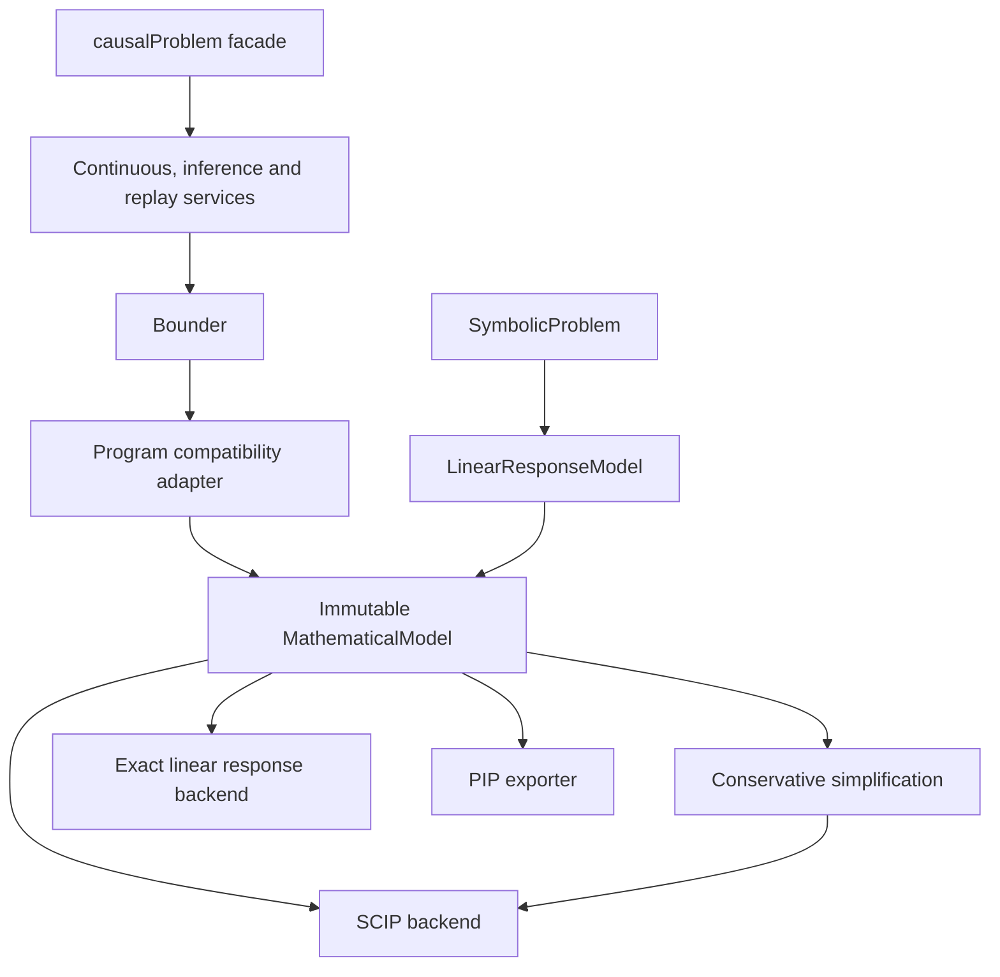

# Architecture and compatibility boundaries

Autobounds separates causal declarations, compiled mathematics, transformations,
solver execution, and inference workflows. Existing public entry points remain:
`Bounder`, `causalProblem`, `SymbolicProblem`, `Program.run_scip()`, and
`LinearResponseModel.solve()`.



## Mathematical representation

`model.py` defines frozen, validated objects:

- `Variable`: name, explicit lower/upper bounds, decision/parameter role, and
  optional display label. A missing bound means unbounded.
- `Term` and `Polynomial`: rational coefficients and monomials, retaining
  repeated variables as powers. Like terms are collected deterministically.
- `Constraint`: a polynomial compared with zero using `==`, `<=`, or `>=`.
- `MathematicalModel`: variables, constraints, and an explicit objective.

Coefficients are exact rationals. Decimal inputs are interpreted by their
written decimal value. Declared-variable checks prevent unknown strings from
silently becoming model variables. Compilation snapshots mutable legacy rows;
subsequent edits to a `Program` do not alter an existing compiled model.

`Program.compile()`, `Bounder.compile()`, `LinearResponseModel.compile()`, and
`SymbolicProblem.compile()` all produce this representation. Symbolic models
carry data as parameter-role variables with their original labels. `bind()`
requires all symbolic parameters by internal name and produces a new numerical
model; decision domains and mathematical constraints remain explicit.

`Q` remains the public expression builder, and `Program.parameters` and
`Program.constraints` remain writable compatibility lists. They are converted
at the compilation boundary; solver backends do not interpret those lists.

## Transformations and exports

`polynomial.simplify_model()` takes an immutable model and returns a new model
plus discovered fixed values. It collects terms, removes exact duplicate rows
and tautologies, and propagates permitted single-variable equalities. Defining
equalities and domains remain. It does not perform general linear elimination
or divide by variable expressions. `Program.simplify()` adapts this operation
back to the legacy mutable interface. See [simplification rules](simplifications.md).

`exporters.write_pip()` consumes the same compiled model as SCIP. It refuses
unbound symbolic parameters and exports explicit domains, including free and
one-sided variables. PIP and SCIP remain numerical interfaces: conversion of
rational coefficients to floating point is not an exact symbolic guarantee.

## Backend contracts and results

`backends.base.Backend` specifies `supports(model)` and `solve(model, **options)`.
There is no automatic fallback to a backend with weaker semantics.

- `backends.scip.ScipBackend` accepts numerical polynomial models. It owns
  native model construction, worker processes, temporary directories, DGP
  loading, and cleanup. Log parsing/monitoring lives in `backends.scip_logs`.
  Nonlinear objectives use an auxiliary variable; arbitrary explicit domains
  are supported. Each backend instance owns run state; use separate instances
  for concurrent solves. Worker execution still requires multiprocessing `fork`.
- `backends.cdd.CddBackend` accepts only normalized, unrestricted linear
  response mixtures: simplex weights, symbolic affine data equalities, and a
  linear target. It checks that structure before exact hull enumeration. It
  rejects general nonlinear models and extra restrictions it cannot represent.
  A common representation does not make every backend applicable to every model.

SCIP returns a structured `SolverResult` with lower/upper `EndpointResult`
objects. `Program.run_scip()` preserves the old tuple/dictionary return format
and stores the structured result in `program.last_result`. Compatibility
results are copied, including DGP dictionaries. Exact results remain
`SymbolicBounds`, now implemented in `symbolic_results.py` and re-exported from
the old import locations.

Missing numerical dual bounds are treated as unbounded, never replaced by an
assumed ATE range of `[-1, 1]`. Backend-owned temporary files are cleaned even
if worker creation fails. Debug files remain available under the existing
explicit debug option.

## One model, two applicable backends

```python
from fractions import Fraction
from autobounds import LinearResponseModel
from autobounds.backends.cdd import CddBackend
from autobounds.backends.scip import ScipBackend

response = LinearResponseModel([[0, 1, 1]], [0, 0, 1], labels=["observed"])
model = response.compile()
formulas = CddBackend().solve(model)
numeric = model.bind({"p0": Fraction(3, 5)})
result = ScipBackend().solve(numeric, verbose=False)
# Both representations give lower 0 and upper 0.6 for observed = 3/5.
```

## Orchestration and ownership

`causalProblem` is the backward-compatible owner of declarations, loaded data,
operation history, and bounders. Its private forwarding methods preserve
existing signatures and monkeypatch points while delegating algorithms to:

- `workflows.continuous`: discretization, category/threshold problem construction,
  and continuous-outcome aggregation.
- `workflows.inference`: covariate handling, subsampling, confidence intervals,
  and parallel replication orchestration.
- `workflows.replay`: input snapshots, operation recording, and replay setup.

Each service has an explicit owning problem; it does not import the
`causalProblem` class or create a second copy of analysis state. Deepcopy and
pickle tests verify that copied services point to the copied owner. Shared
statistical/data helpers live in `data_utils.py`, so `Bounder` no longer imports
its orchestrator. Old helper import locations remain compatibility re-exports.

The facade is roughly 680 lines instead of 2,250; moving algorithms does not
by itself make them pure. Mutable user-facing configuration and compatibility
forwarding intentionally remain. The workflows can be narrowed further into
smaller functions without changing the mathematical or backend contracts.

## Verification and limits

Regression coverage includes immutable compilation, exact coefficient handling,
domain preservation, symbolic parameter binding, backend capability rejection,
matching exact/numerical endpoints, nonlinear numerical objectives, PIP
round-trips, worker-failure cleanup, copied workflow ownership, inference/replay,
and original public API behavior.

This refactor adds no QE/Redlog backend, no general-purpose exact nonlinear
solver, and no spawn-based worker implementation. It provides the mathematical
and execution boundaries those additions need. Tests in one environment do not
establish a Python/OS compatibility matrix or numerical equivalence for every
ill-conditioned input.

The completed refactor passed **305 tests** in the source checkout (18.49
seconds) and **305 tests** against the installed wheel outside the checkout
(18.69 seconds). Both distributions built successfully. The small numerical
subsampling example and exact symbolic factorial example also completed.
These runs used Linux, Python 3.13, and the existing dependency environment.
